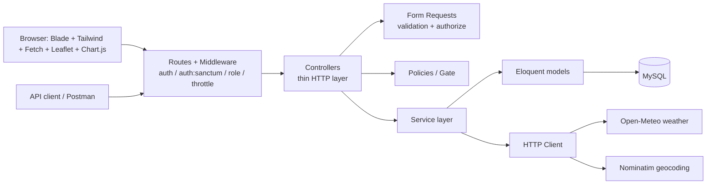

# Architecture

| Layer | Classes | Responsibility |
|---|---|---|
| Routes / middleware | `routes/web.php`, `routes/api.php`, `EnsureRole` | auth, role gate, rate limit |
| Controllers | `Web\*`, `Api\*` | translate HTTP <-> service calls, no business rules |
| Form Requests | `Store*Request`, `Update*Request` | validation and first authorization check |
| Policies | `ShipmentPolicy` | who may view / update / delete / add tracking |
| Services | `ShipmentService`, `TrackingService`, `EtaService`, `ExceptionService`, `NotificationService`, `AuditService`, `DashboardService`, `WeatherService`, `GeocodingService` | all business rules and transactions |
| Models | Eloquent | relations, casts, scopes (`visibleTo`, `filter`, `sortBy`) |

The same services are used by the web UI and the REST API, so a rule (for example the status state machine) exists in exactly one place.

## Request flow example: add tracking event
1. `POST /api/shipments/{id}/tracking` -> `auth:sanctum` -> `TrackingController@store`
2. `StoreTrackingEventRequest`: validates fields and checks `ShipmentPolicy::addTracking`
3. `TrackingService::addEvent` (DB transaction, row lock): terminal check -> time rules -> state-machine check -> insert event -> update shipment snapshot -> `EtaService::refresh` -> notifications -> audit log
4. A broken rule throws `BusinessRuleException` -> `422` JSON (API) or redirect with flash error (web)
