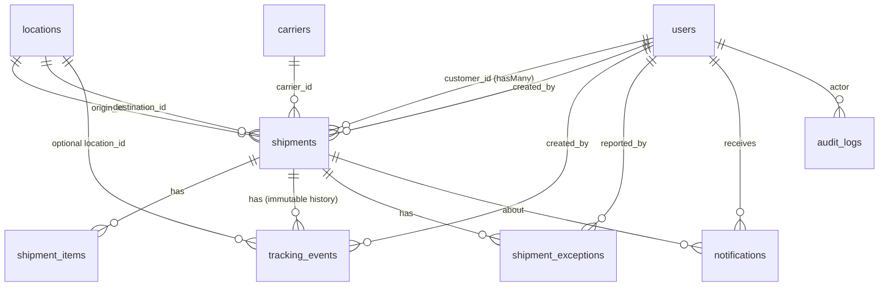

# Entity Relationship Diagram

## Cardinality and design decisions

| Relation | Cardinality | Why |
|---|---|---|
| user (customer) -> shipments | 1 : N | A customer owns many shipments; each shipment has exactly one customer. This is the basis of "customer only sees own shipments". |
| carrier -> shipments | 1 : N | One carrier moves many shipments. Carriers are deactivated (`is_active`), never deleted, so history stays valid (`restrictOnDelete`). |
| location -> shipments (origin / destination) | 1 : N twice | Two separate foreign keys to the same table. Validation forbids origin = destination. |
| shipment -> tracking_events | 1 : N | Events are an append-only history. The model blocks `update`, so old events are never overwritten. |
| shipment -> shipment_exceptions | 1 : N | A shipment can have several exceptions over time, each with its own lifecycle (OPEN -> INVESTIGATING -> RESOLVED). |
| shipment -> shipment_items | 1 : N | Cargo lines belonging to one shipment (cascade delete). |
| user -> notifications | 1 : N | In-app inbox, filtered by `read_at`. |
| user -> audit_logs | 1 : N (nullable) | Who did what; `null` user = system/seed. `nullOnDelete` keeps the log if a user is removed. |

Other decisions
- **Denormalised snapshot on `shipments`** (`current_status`, `current_latitude/longitude/label`, `last_event_at`, `is_delayed`, `delay_hours`, `delay_severity`): written only by the service layer, so lists, filters and the dashboard can use plain SQL instead of joining the event table. The event table stays the source of truth.
- **Soft delete only on `shipments`** (deleting a shipment must not destroy audit/tracking evidence).
- **Indexes:** unique `shipment_number`, `carriers.code`, `locations.code`, `users.email`; indexes on `current_status`, `is_delayed`, `expected_arrival_at`, `customer_id` (FK), `(shipment_id, occurred_at)`, `(shipment_id, status)`, `(user_id, read_at)`, `(entity_type, entity_id)`.
- **Enums stored as strings** and validated by PHP backed enums (portable between MySQL and SQLite tests).
